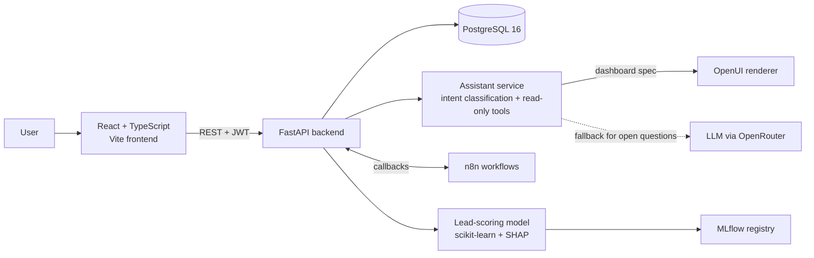

<div align="center">

# 🧭 FlowPilot AI

**An AI assistant for business-process automation: CRM, HR leave and workflow monitoring, with lead scoring, explainability and a conversational dashboard generator.**

*End-of-studies project (PFE), Tek-Up University*


</div>

---

## Table of contents

- [What it does](#what-it-does)
- [Architecture](#architecture)
- [The AI assistant](#the-ai-assistant)
- [Lead scoring (ML)](#lead-scoring-ml)
- [Access control](#access-control)
- [Tech stack](#tech-stack)
- [Getting started](#getting-started)
- [Project structure](#project-structure)
- [Testing](#testing)
- [Status and limitations](#status-and-limitations)

## What it does

FlowPilot AI is a web application that centralises three business domains behind one assistant:

| Domain | Capabilities |
|---|---|
| **CRM** | Leads, deals, tasks, interactions, AI-drafted follow-up e-mails with human review and approval, lead-to-customer conversion |
| **HR / Leave** | Leave requests, allocation, manager approval, HR validation |
| **Automation** | Monitoring of n8n workflow executions (success, failure, pending) and retries |

On top of that, a **French-language assistant** answers questions such as *"Give me a CRM summary"* with a generated dashboard (KPI cards, charts, tables, recommendations).

## Architecture



## The AI assistant

1. **Classify the intent** of the question (CRM, leave, automation, comparison, drafts…).
2. **Call read-only data tools** that query the database. The assistant never writes on its own.
3. **Generate a dashboard** (KPI, donut, bars, funnel, tables, observations, action buttons) rendered by a safe component library. If generation fails, it falls back to a static answer.

The optional LLM fallback (`OPENROUTER_API_KEY`) is used only for open-ended questions and can be left empty. Technical details are in [`DOCUMENTATION_ASSISTANT.md`](DOCUMENTATION_ASSISTANT.md) (French).

## Lead scoring (ML)

A conversion-prediction model ranks CRM leads. Training data is **synthetic**, generated by [`ml/generate_leads_dataset.py`](ml/generate_leads_dataset.py) so it matches the real lead schema without exposing customer data.

| Model | AUC-ROC |
|---|---|
| **Logistic Regression** (production, v1.0) | **0.7935** |
| LightGBM | 0.7817 |
| Random Forest | 0.7851 |
| XGBoost | 0.7801 |
| LLM baseline | 0.7200 |

4,000 training samples, 68 features. Explainability with **SHAP** (global and per-lead), experiment tracking and a versioned model registry with **MLflow**. Artifacts are in [`ml/artifacts/`](ml/artifacts/).

> The labels come from a noisy probabilistic process, so these scores show the pipeline and evaluation method, not performance on real customers.

## Access control

JWT authentication and a permission model with 28 fine-grained permissions (for example `crm.leads.update`, `crm.email.send`, `leave.request.approve`, `workflow.executions.retry`), managed from an admin UI for users and roles.

## Tech stack

| Layer | Tools |
|---|---|
| Backend | Python, FastAPI, SQLAlchemy, Pydantic, JWT |
| Database | PostgreSQL 16 (Docker) |
| Frontend | React, TypeScript, Vite, React Router |
| Automation | n8n (workflow JSON in [`workflows/`](workflows/)) |
| ML | scikit-learn, XGBoost, LightGBM, SHAP, MLflow |
| LLM | OpenRouter (optional fallback), OpenUI-style generated dashboards |

## Getting started

**Prerequisites:** Python 3.11+, Node 18+, Docker.

```bash
# 1. Database
cp .env.example .env            # then edit the values
docker compose up -d postgres

# 2. Backend
cd backend
python -m venv .venv && source .venv/bin/activate     # Windows: .venv\Scripts\activate
pip install -r requirements.txt
python -m uvicorn app.main:app --reload               # http://localhost:8000/docs

# 3. Frontend (new terminal)
cd frontend
npm install
npm run dev
```

Demo data: see [`backend/seed_demo_leads.py`](backend/seed_demo_leads.py) and [`docs/DATABASE_SEEDING.md`](docs/DATABASE_SEEDING.md). n8n can be started with `docker-compose-n8n.yml`.

## Project structure

```
.
├── backend/            FastAPI app (api, services, models, schemas, core/permissions)
│   └── tests/          60 tests: CRM, assistant, n8n callbacks, leave, e2e
├── frontend/           React + TypeScript app (17 pages)
├── ml/                 dataset generator, training, SHAP, MLflow, artifacts
├── workflows/          n8n workflow exports
├── docs/               smoke tests, API contracts, database plans
├── flowpilot_odoo/     Odoo integration experiments
└── docker-compose.yml  PostgreSQL
```

## Testing

```bash
cd backend && pytest -q
```

Manual smoke-test procedures for each module are in [`docs/`](docs/).

## Status and limitations

- Academic project, not production-hardened. Change every default credential in `.env` and `docker-compose.yml` before any deployment.
- Lead scoring is trained on synthetic data.
- The Odoo integration is experimental.
