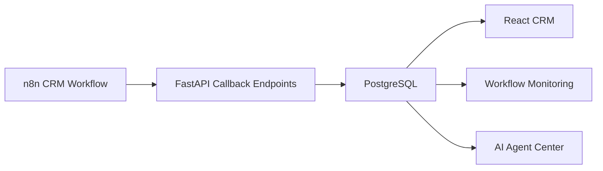

# FlowPilot AI CRM n8n Workflows 01/02 Smoke Test

Date: 2026-05-01  
Status: Step 61.1 and Step 61.2 completed

## 1. Purpose

This document validates the end-to-end integration of the first two CRM n8n workflows with FlowPilot AI:

- FP_CRM_01_Lead_Intake_AI_Scoring_Routing
- FP_CRM_02_Communication_Draft

The objective of this smoke test is to confirm that CRM events produced by n8n are received by FastAPI, persisted in PostgreSQL, and then visible in the React application for operational follow-up and traceability.

## 2. Architecture validated



Validated architecture flow:

```text
n8n CRM Workflow -> FastAPI callback endpoints -> PostgreSQL -> React CRM / Workflow Monitoring / AI Agent Center
```

The source-of-truth tables for this integration are:

- crm_leads
- crm_interactions
- workflow_executions
- agent_runs

Legacy tables are not used in the validated FlowPilot AI CRM persistence path:

- leads
- lead_analysis
- lead_scores
- lead_actions
- lead_communications
- lead_followups

## 3. Workflow 01 validation

Workflow name: FP_CRM_01_Lead_Intake_AI_Scoring_Routing

Purpose:

- lead intake
- validation
- normalization
- AI analysis
- scoring
- routing
- CRM next action
- CRM interaction history
- workflow traceability
- AI agent traceability

Validated callbacks:

- POST /api/n8n/crm/collect-result -> 200 OK
- POST /api/n8n/crm/analysis-result -> 200 OK
- POST /api/n8n/crm/scoring-result -> 200 OK
- POST /api/n8n/crm/routing-result -> 200 OK

Tables updated:

- crm_leads
- crm_interactions
- workflow_executions
- agent_runs

Expected interaction types:

- lead_collected
- ai_analysis
- scoring_completed
- routing_decision

Expected agent runs:

- crm_ai_analysis_agent
- crm_predictive_scoring_agent
- crm_routing_agent

Operational result:

- The lead is inserted into crm_leads.
- CRM interaction history is written into crm_interactions.
- Workflow execution trace is stored in workflow_executions.
- Agent execution trace is stored in agent_runs.

## 4. Workflow 02 validation

Workflow name: FP_CRM_02_Communication_Draft

Purpose:

- generate communication draft
- do not send email automatically
- save draft as CRM interaction
- create workflow trace
- create agent run trace

Validated callback:

- POST /api/n8n/crm/communication-result -> 200 OK

Expected interaction type:

- communication_draft

Expected agent run:

- crm_communication_agent

Important rule:

- No email is sent automatically.
- The generated communication remains a draft for human validation.

Operational result:

- The draft is persisted as a CRM interaction.
- The workflow trace is available for monitoring.
- The agent trace is available in the AI Agent Center.

## 5. Test lead used

The smoke test used the following lead identifier:

```json
{
  "lead_id": "lead_n8n_trace_test_001",
  "full_name": "Nour Ben Salem",
  "email": "nour.bensalem@example.com",
  "phone": "+21622333444",
  "company_name": "Smart Business Tunisia",
  "source": "website_form",
  "message": "Nous voulons automatiser notre processus commercial avec un CRM intelligent et prioriser les prospects les plus importants.",
  "location": "Sfax, Tunisia",
  "product_service": "AI CRM Automation",
  "estimated_value": 18000,
  "notes": "Test trace workflow_executions and agent_runs",
  "consent_to_contact": true,
  "requested_by": "user_030"
}
```

## 6. Manual test commands

Start PostgreSQL:

```powershell
cd D:\SMA_PFE
docker compose up -d postgres
```

Start the FastAPI backend:

```powershell
cd D:\SMA_PFE\backend
.\.venv\Scripts\python.exe -m uvicorn app.main:app --reload
```

Open n8n in the browser:

```text
http://localhost:5678
```

Test Workflow 01:

```powershell
$headers = @{
	"X-FlowPilot-Secret" = "flowpilot-test-secret"
}

$body = @{
	lead_id = "lead_n8n_trace_test_001"
	full_name = "Nour Ben Salem"
	email = "nour.bensalem@example.com"
	phone = "+21622333444"
	company_name = "Smart Business Tunisia"
	source = "website_form"
	message = "Nous voulons automatiser notre processus commercial avec un CRM intelligent et prioriser les prospects les plus importants."
	location = "Sfax, Tunisia"
	product_service = "AI CRM Automation"
	estimated_value = 18000
	notes = "Test trace workflow_executions and agent_runs"
	consent_to_contact = $true
	requested_by = "user_030"
} | ConvertTo-Json -Depth 10

Invoke-RestMethod -Method Post `
	-Uri "http://localhost:5678/webhook-test/flowpilot-crm-lead-intake" `
	-Headers $headers `
	-ContentType "application/json" `
	-Body $body
```

Test Workflow 02:

```powershell
$headers = @{
    "X-FlowPilot-Secret" = "flowpilot-test-secret"
}

$body = @{
    lead_id = "lead_n8n_trace_test_001"
    full_name = "Nour Ben Salem"
    email = "nour.bensalem@example.com"
    phone = "+21622333444"
    company_name = "Smart Business Tunisia"
    source = "website_form"
    message = "Nous voulons automatiser notre processus commercial avec un CRM intelligent et prioriser les prospects les plus importants."
    product_service = "AI CRM Automation"
    intention = "purchase"
    urgency = "high"
    priority = "high"
    ai_summary = "Lead intéressé par une solution CRM intelligente avec un fort potentiel commercial."
    recommended_action = "Planifier une démonstration et envoyer une proposition personnalisée."
    requested_by = "user_030"
} | ConvertTo-Json -Depth 10

Invoke-RestMethod -Method Post `
    -Uri "http://localhost:5678/webhook-test/flowpilot-crm-communication-draft" `
    -Headers $headers `
    -ContentType "application/json" `
    -Body $body
```

## 7. SQL verification

CRM lead:

```sql
SELECT id, full_name, customer_status, status, lead_score, priority, next_action
FROM crm_leads
WHERE id = 'lead_n8n_trace_test_001';
```

CRM interactions:

```sql
SELECT lead_id, interaction_type, channel, summary, created_at
FROM crm_interactions
WHERE lead_id = 'lead_n8n_trace_test_001'
ORDER BY created_at ASC;
```

Workflow executions:

```sql
SELECT id, workflow_name, process, status, related_object_id
FROM workflow_executions
WHERE related_object_id = 'lead_n8n_trace_test_001'
ORDER BY created_at ASC;
```

Agent runs:

```sql
SELECT id, agent_id, agent_name, process, status, workflow_execution_id
FROM agent_runs
ORDER BY created_at DESC
LIMIT 10;
```

Expected interaction types:

- lead_collected
- ai_analysis
- scoring_completed
- routing_decision
- communication_draft

Expected agents:

- crm_ai_analysis_agent
- crm_predictive_scoring_agent
- crm_routing_agent
- crm_communication_agent

## 8. Frontend verification

The following pages are used to confirm that the workflow outputs are visible in the UI:

- /crm-leads
- /crm-lead-details
- /workflow-monitoring
- /ai-agents

Expected frontend results:

- CRM lead data is available through the UI or API.
- interaction_history includes communication_draft.
- Workflow Monitoring shows CRM traces.
- AI Agent Center shows CRM agent runs.

## 9. Issues fixed during testing

Issue 1: collect-result initially failed with a ForeignKeyViolation because crm_interactions was inserted before crm_leads was flushed.

Fix: FastAPI now flushes crm_leads before inserting crm_interactions.

Issue 2: workflow_executions and agent_runs were not initially populated.

Fix: FastAPI callback schemas and services were updated to accept and persist optional workflow_execution and agent_run objects.

Issue 3: PowerShell curl test failed because JSON file format was invalid.

Fix: Used PowerShell hashtable + ConvertTo-Json + Invoke-RestMethod.

## 10. Security and MVP notes

Current local secret used during smoke testing:

- flowpilot-test-secret

Security and deployment guidance:

- Future secrets should be stored in environment variables or n8n credentials.
- No real API keys should be committed.
- No automatic email sending should occur without human validation.

Recommended future variables:

- FASTAPI_BASE_URL
- FLOWPILOT_N8N_SHARED_SECRET
- FLOWPILOT_FASTAPI_CALLBACK_SECRET
- OPENROUTER_API_KEY
- OPENROUTER_MODEL
- FLOWPILOT_APP_URL

## 11. What is now real

The following capabilities are now validated end to end:

- lead intake through n8n
- AI analysis
- scoring
- routing
- CRM interaction history
- workflow monitoring traces
- AI agent traces
- communication draft generation
- communication draft persistence

## 12. What remains for later

The following capabilities remain for future implementation:

- trigger workflows from React UI
- FastAPI trigger endpoint for communication draft
- Workflow 03 Human Conversion
- Workflow 04 inactive customer follow-up
- Workflow 05 VIP update
- Workflow 06 customer activity analysis
- Odoo sync
- real auth/RBAC
- email approval/send UI
- production monitoring
- automated tests

Workflow 04 and Workflow 05 must remain disabled until these backend endpoints exist:

- GET /api/n8n/crm/inactive-customers
- GET /api/n8n/crm/vip-candidates

## 13. Completion status

- Step 61.1 completed: FP_CRM_01 Lead Intake AI Scoring Routing integrated and tested end-to-end.
- Step 61.2 completed: FP_CRM_02 Communication Draft integrated and tested end-to-end.
- Step 61.3 completed: CRM n8n Workflows 01/02 Integration Smoke Test Documentation created.

## 14. Recommended next step

Step 61.4 - Add FastAPI and React Trigger for Communication Draft

Purpose:

- Allow the user to trigger FP_CRM_02 from the FlowPilot AI interface instead of manually using PowerShell.

Expected future flow:

```text
React CRM Lead Details -> Click Generate Communication Draft -> FastAPI trigger endpoint -> n8n Workflow 02 -> FastAPI communication-result callback -> PostgreSQL -> React displays communication_draft in interaction history
```

This next step would turn the validated smoke test into a user-facing CRM action inside the FlowPilot AI application.